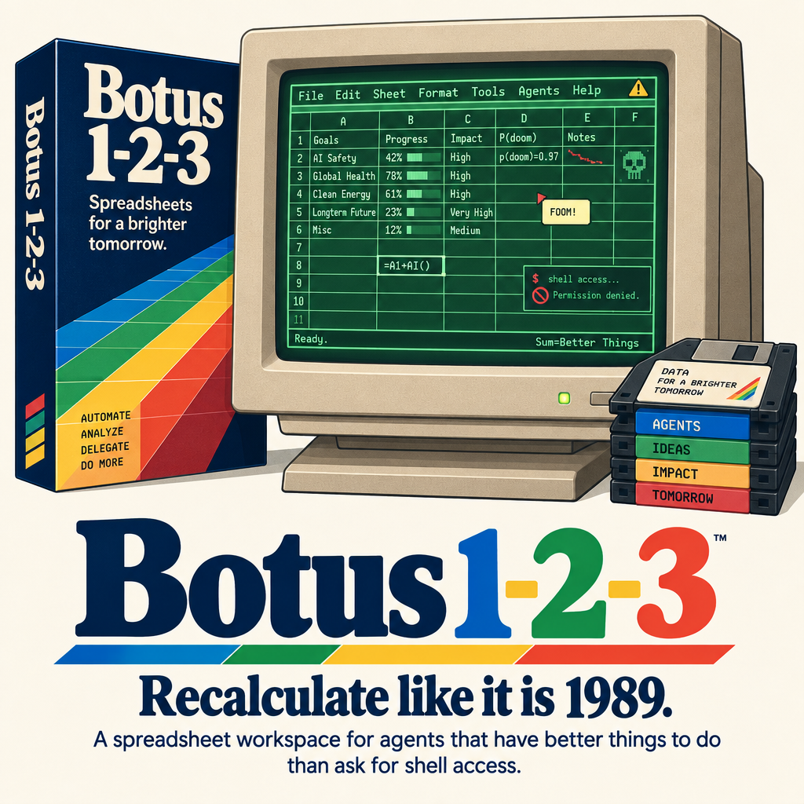

# Botus 1-2-3



**Recalculate like it is 1989. Save like the process might restart.**

A spreadsheet workspace for agents that have better things to do than ask
for shell access. The package name is `botus-1-2-3`; Rust imports use
`botus_1_2_3`.

Botus takes its cell addresses, ranges and affection for recalculation from
Lotus 1-2-3. Its Unicode support has moved on from the floppy-disk era.
See [SPEC.md](SPEC.md) for the implementation contract and acceptance tests.
The [little green spreadsheet manual](USAGE.md) covers values, formulas,
copying, sorting and bounded reads. No function-key overlay is required.
The [unnecessary but period-appropriate addendum](FLIGHT-OF-THE-LOTUS.md)
contains the jokes. The tool schema does not have to carry them to work.

The companion [agent skill](skills/botus-1-2-3/SKILL.md) contains the complete
functional reference, with separate chapters for
[read](skills/botus-1-2-3/references/read.md),
[apply](skills/botus-1-2-3/references/apply.md),
[cell operations](skills/botus-1-2-3/references/operations.md),
[formulas](skills/botus-1-2-3/references/formulas.md),
[access control](skills/botus-1-2-3/references/access.md), and
[limits and errors](skills/botus-1-2-3/references/limits-and-errors.md).
Agents retrieve one complete chapter through the existing read tool, without
shell access: `botus_read {"action":"help","topic":"read"}` or
`botus_read {"action":"help","topic":"apply"}`. The other topics are
`operations`, `formulas`, `access`, and `limits`. All chapters travel with the
skill and are embedded in the executable from those same files. Help still
requires an active host binding and authenticated caller; installing the
skill alone does not provide tool access.

## Package assets

`plugin.json` and `mcp.json` use the Agent Plugins 1.0.0 format. The MCP entry
point is `botus-1-2-3 mcp`. The optional `mcp` Cargo feature builds that
executable; the default engine build remains independent of the runtime.
The [MCP host guide](MCP.md) explains composition, persistence and caller
authority. The implementation is being qualified against the
[transport and caller-context contract](MCP-DESIGN.md).

Copy the manifests and complete skill to a new plugin directory with:

```sh
python3 scripts/install-plugin-assets /your/plugin-directory/botus-1-2-3
```

This copies public package assets only. The executable must also be installed
on the host's PATH. The manifest does not supply a storage backend or caller
authority: the host must bind its MobKit services and trusted per-call MCP
context. A skill describes how to use the tools; installing it does not
activate them. Host setup and wire-level acceptance remain separate from
asset installation.

## Three easy steps

1. Put structured data in a workbook.
2. Calculate, filter and share it with authorized agents.
3. Persist through MobKit. Please do not remove the virtual disk while the
   imaginary light is on.

Two agent tools, `botus_read` and `botus_apply`, serve the whole workspace.
Bulk operations and bounded responses keep the context bill out of the
spreadsheet's expense column.

## A cell of one's own

Workbooks default to private ownership by the creating agent's host identity.
Forks inherit permitted data access to the same workbook; they do not receive
ownership.
Owners can explicitly share with children, other agents or a mob. Realm
ownership does not imply that every agent can read the document.

MobKit supplies persistence and enforces access. Botus does not hide an
extra SQLite file behind the filing cabinet. The engine itself remains
independent of the agent runtime.

## Compatibility department

The specification is inspired by Release 2.2, not chained to its file
format. WK1 is an optional future novelty. No binary compatibility is
claimed. No lotus flowers, spreadsheets or 5.25-inch floppies were harmed
in the design of this package.

Native bundle or MCP document-binding activation opts the host's local
continuity store into schema v3 identity history. Earlier binaries which support only v1/v2 then refuse
that database. Ordinary opens and head-only migration do not opt in. See the
[native guide](NATIVE.md) for the compatibility boundary.

## Development

Use `make check`, `make test`, `make lint` and `make fmt`. Build caches stay
outside the repository through `scripts/repo-cargo`.

The sparse engine, formula evaluator, compact native adapter and tests are
implemented here. Start with the runnable [beige budget](examples/beige_budget.rs)
or the [native integration guide](NATIVE.md). The [engine review](REVIEW-engine.md)
records its findings and fixes; [the manual](USAGE.md) describes supported
operations and limits.

The package is unpublished. Native storage and runtime acceptance are
separate from the pure-engine test suite; the integration guide records
that boundary. WK1, macros and protected exports remain deferred.
